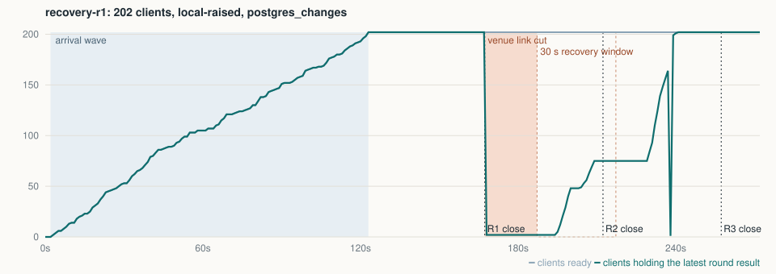

# Report: conference load rehearsal

**Local reference app on one machine; not measurements of any production platform.** Load generator, Next.js (`next start`) and the local Supabase stack shared that machine; generator CPU and scheduling delay were recorded in every run.

<!-- brief:start -->
**Do 200 devices hold?** On this local bench, with existing sessions and raised Realtime limits, 200 participants completed normal rounds; after a simulated 20-second outage, the facilitator could not open round 3 in 4 of 6 runs while the local API gateway saturated. These are scenarios to rehearse before an event; hosted capacity still needs a representative test of the real sign-in, submission and result-display flows.

This reference scenario sends live results to every participant device; who receives updates during the real session still needs confirming.

- **Connections.** 204 live connections are needed (200 phones, facilitator, display, two real browsers). At the Free plan's limit of 200, 4 screens were refused; with it raised, every screen got every result within 5 s.
- **Signing in on arrival.** From one venue address, Auth's per-address limits let 30 of 200 new anonymous users through; reused sessions: 200 of 200.
- **After a Wi-Fi drop.** After a simulated 20-second outage that left old connections stale, clients attempted to reconnect. The facilitator could not start round 3 in 4 of 6 runs; the jam formed in the local API gateway, so this scenario needs repeating on a representative deployment.
<!-- brief:end -->

<!-- chart:start -->

<!-- chart:end -->

Every figure by scenario: [README](README.md#results). What broke, run by run, with the diagnosis: [FINDINGS.md](FINDINGS.md). Checks for your own deployment: [README](README.md#five-checks-for-your-own-deployment).

## What each environment can and cannot establish

| Environment | What it can establish | What it cannot establish |
|---|---|---|
| Local Next.js + Supabase (this repository) | Reference-app correctness, query behaviour, configured limiter behaviour, delivery and recovery under generated load | Managed-plan capacity, Vercel behaviour, venue network performance |
| Owned free hosted Supabase project (optional, not run here) | Behaviour of that project's gateway, Auth, Realtime and database configuration under a permitted workload | Your configuration, a paid plan's capacity, the complete Vercel application path |
| Authorised representative deployment, later | Behaviour of the real application paths and configuration tested | Conditions left out of the test, including the physical venue network |

Local limit profiles are labelled *local default* (as the CLI seeded them, equal to the published Free values), *local with published Pro values* and *local with selected limits raised*. None of them is a Free or Pro benchmark.

## Not covered

Hosted Supabase probes (optional, not run), runs past the local gateway's 512-connection ceiling (it would need a reconfigured gateway), any Vercel deployment, real venue Wi-Fi and mobile browsers. Token expiry was not exercised. A separate burst of 200 single-attempt token refreshes was tested before expiry.
